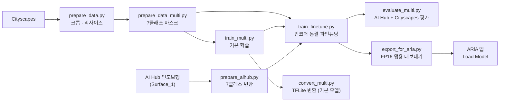

# 보행 환경 인식 세그멘테이션 모델 (AI 모델 파트)

카메라 영상에서 **걸을 수 있는 영역(인도·횡단보도)과 막힌 영역(도로·사람·차량·기둥/표지판 등)을 픽셀 단위로 구분**하는 경량 시맨틱 세그멘테이션 모델
안드로이드 앱에서 온디바이스(LiteRT/TFLite)로 실행하는 것을 목표로 하며, 이 문서는 모델 학습부터 앱 연동까지 AI 파트의 작업 내용을 정리


---

## 1. 한눈에 보기

| 항목 | 내용 |
|---|---|
| 태스크 | 시맨틱 세그멘테이션 (7클래스) |
| 모델 | MobileNetV2 인코더(ImageNet 사전학습) + 경량 U-Net 디코더 |
| 학습 데이터 | Cityscapes (기본 학습, 라벨을 7클래스로 합쳐서 사용) + AI Hub 인도보행 (파인튜닝) |
| 학습 입력 | 224 × 512 (H × W), RGB, 0~255 |
| 앱용 입력 | 288 × 512 (H × W), RGB, 0~1 float32 |
| 출력 | `[1, H, W, 7]` 클래스별 확률(softmax) → 픽셀별 argmax |
| 배포 형식 | `.tflite` (LiteRT 호환, FP16 가중치 약 10.3MB, 입출력 float32), 앱에서 직접 불러와 테스트 |

### 파이프라인



---

## 2. 설계 결정 기록

| 결정 | 이유 |
|---|---|
| 이미지 단위 이진분류 → **픽셀 단위 세그멘테이션** | 분류는 "장애물 있음/없음"만 알려주지만, 세그멘테이션은 길이 어느 쪽에 열려 있는지(좌/중/우)까지 알 수 있음. 학습하지 않은 물체도 "걸을 수 있는 바닥이 아니면" 막힌 곳으로 처리됨 |
| 객체 검출(OD) 모델은 제외 | 박스/이름보다 "걸을 수 있는 영역"이 이 프로젝트에 더 직접적이고, 모델 하나로 단순하게 유지하기 위함 |
| **도로는 보행 불가로 분류** | 보행 가능 = 인도 + 횡단보도 |
| 공개 사전학습 세그멘테이션 모델을 그대로 쓰지 않음 | 공개 모델은 자기 데이터셋의 클래스 체계(예: Cityscapes 19클래스)를 따라서 원하는 6클래스와 맞지 않음. 라벨을 합쳐서 직접 학습 |
| 시맨틱(영역) 세그멘테이션 | 같은 클래스의 객체는 하나의 영역으로 묶임 (사람 2명 → 하나의 `person` 영역). 개별 객체 구분(인스턴스)은 모바일에서 무거워 제외 |
| 인코더로 MobileNetV2 사용 | U-Net 스킵 연결 레이어가 잘 알려져 있고 TFLite 변환이 안정적 |
| 학습 이미지 아래쪽 크롭 | Cityscapes 일부 장면에 자동차 보닛이 찍혀 있어, 그대로 두면 "화면 아래 가운데는 항상 막힘"으로 학습됨 |
| **AI Hub 인도보행 데이터로 파인튜닝** | Cityscapes는 자동차 시점이고 횡단보도 라벨이 없어 국내 보행로(보도블록, 점자블록, 횡단보도) 인식이 약함. 보행자 시점의 국내 데이터로 보완 |
| 파인튜닝은 **인코더 동결 + Cityscapes 55% 혼합** | AI Hub 라벨 매핑에는 사람/차량/기둥이 없어 그대로 학습하면 해당 클래스를 잊을 수 있음. 인코더를 고정하고 Cityscapes를 섞어 기존 지식을 보존 |
| 앱용 모델은 FP16 가중치로 내보냄 | 파일 크기를 float32(약 21MB) 대비 절반 수준(약 10.3MB)으로 줄임. 입출력은 float32 유지 |

---

## 3. 클래스 정의

| ID | 클래스 | 원본 라벨 (Cityscapes / AI Hub) | 보행 가능 |
|---|---|---|---|
| 0 | `other` (기타·막힘) | 위에 해당하지 않는 모든 것 (건물, 벽, 울타리, 식생, 지형, 하늘, AI Hub의 배경·맨홀·계단·가로수 구역 등) | ✗ |
| 1 | `road` (도로) | Cityscapes: road, parking, rail track / AI Hub: 차도, 골목길 노면, 과속방지턱, 파손 도로 | ✗ |
| 2 | `sidewalk` (인도) | Cityscapes: sidewalk / AI Hub: 보도블록, 아스팔트·시멘트·우레탄 인도, 파손 인도, 흙/돌 보행로, 점자블록, 자전거 도로 | ✓ |
| 3 | `crosswalk` (횡단보도) | **AI Hub만** (차도 내 횡단보도, 골목길 횡단보도). Cityscapes에는 라벨 없음 (도로에 포함) | ✓ |
| 4 | `person` (사람) | Cityscapes: person, rider | ✗ |
| 5 | `vehicle` (차량) | Cityscapes: car, truck, bus, caravan, trailer, train, motorcycle, bicycle | ✗ |
| 6 | `pole_sign` (기둥·차단봉·표지판) | Cityscapes: pole, polegroup, traffic light, traffic sign | ✗ |

- **보행 가능 클래스는 `{2, 3}`** (`seg_multi.py`의 `WALKABLE`).
- 클래스 개수와 순서는 앱 코드(`WalkableSegmenter.kt`의 `NAMES`)와 반드시 같아야 함.
- 횡단보도(3)는 Cityscapes에 별도 라벨이 없어 기본 학습 직후에는 비어 있었고, AI Hub 파인튜닝으로 학습함 (AI Hub 검증 IoU 0.729). 구조는 7클래스로 고정해 두었기 때문에, 데이터를 추가해 재학습해도 앱 코드는 바뀌지 않음.
- 사람/차량/기둥(4~6)은 AI Hub 매핑에 없어서 AI Hub 이미지에서는 `other`로 변환됨. 이 클래스들은 Cityscapes 혼합과 인코더 동결로 보존.

---

## 4. 데이터

### 4.1 Cityscapes

- 학습 2,975장 / 검증 500장 사용. 시험(test) 셋은 정답이 공개되지 않아 사용하지 않음.
- 다운로드: [cityscapes-dataset.com](https://www.cityscapes-dataset.com) 로그인 후 `gtFine_trainvaltest.zip`, `leftImg8bit_trainvaltest.zip`
- 압축을 품 ("현재 폴더에 풀기"로 풀어서 폴더가 한 단계 더 생기지 않게 주의).

```
cityscapes/
  leftImg8bit/{train,val,test}/<도시>/*_leftImg8bit.png
  gtFine/{train,val,test}/<도시>/*_gtFine_labelIds.png
```

> ⚠️ **라이선스**: Cityscapes는 비상업적 연구 목적의 라이선스. 상업적 사용 가능 여부는 약관을 확인

### 4.2 전처리 (Cityscapes)

| 단계 | 내용 |
|---|---|
| 크롭 | 2048×1024 → 위쪽 2048×896 (아래쪽 보닛 영역 제거) |
| 리사이즈 | 512×224 (이미지는 bilinear, 마스크는 nearest) |
| 라벨 변환 | `labelIds` → 7클래스 ID (위 표) |

### 4.3 AI Hub 인도보행 (파인튜닝용)

- 폴더 `Surface_1/` 기준. 원본 `jpg`와, 그 아래 `MASK/` 폴더의 같은 이름 `png`(RGB 색상 마스크)를 짝지어 사용
- 2,000장 샘플링 (seed 42), 15%를 검증으로 분리 (2,000장 기준 검증 300 / 학습 1,700)
- 마스크 색상 → 7클래스 변환은 `prepare_aihub.py`의 `COLOR_MAP`. 매핑에 없는 색상은 전부 `other`(0)

| 클래스 | AI Hub 라벨 |
|---|---|
| 2 `sidewalk` | blocks5(보도블록), asphalt5, cement5, damaged5, other5, soil_stone5, urethane, normal2(점자블록), damaged2, bike_lane1 |
| 3 `crosswalk` | crosswalk4(차도 내), crosswalk0(골목길) |
| 1 `road` | normal4(차도), normal0(골목길 노면), speed_bump0, damaged0 |
| 0 `other` | 그 외 전부 (배경, 맨홀, 계단, 가로수 구역 등) |

| 단계 | 내용 |
|---|---|
| 크롭 | 512:224 비율로 위쪽(하늘)을 잘라내고 아래쪽(노면)을 유지 |
| 리사이즈 | 512×224 (이미지는 `INTER_AREA`, 마스크는 `INTER_NEAREST`) |
| 라벨 변환 | RGB 마스크 → 클래스 ID(0~6), 변환 후 클래스별 픽셀 분포 출력 |

- `inspect_mask.py`: `Surface_1/`의 마스크 색상 구성과 XML 정의를 확인하는 보조 스크립트
- 현재 매핑에는 사람/차량/기둥이 없어 AI Hub 검증에서 해당 클래스 정답은 0%

> ⚠️ **라이선스/이용 약관**: AI Hub 이용 약관을 확인. **데이터 원본(이미지·마스크)은 저장소에 올리지 않음**

---

## 5. 모델

```
입력 (224×512×3, 0~255)
  → Rescaling(1/127.5, offset=-1)            # MobileNetV2 입력 범위 [-1, 1]
  → MobileNetV2 인코더 (ImageNet 사전학습)
       스킵: block_1_expand_relu / block_3_expand_relu / block_6_expand_relu
             block_13_expand_relu / block_16_project
  → 디코더: [Conv2DTranspose → 스킵 Concat → Conv2D] × 4단계 (256/128/64/32)
  → Conv2DTranspose(16) → Conv2D(1×1, 7, softmax)
출력 (224×512×7)
```

구조는 합성곱으로만 이뤄져 있어서 가중치를 그대로 두고 입력 크기만 바꿔 내보낼 수 있음, (`export_for_aria.py`, 288×512). 입력 크기는 **32의 배수**

---

## 6. 학습

### 6.1 기본 학습 (Cityscapes)

| 항목 | 값 |
|---|---|
| 손실 | Sparse Categorical Cross-Entropy + Multi-class Dice |
| 지표 | Mean IoU |
| 배치 | 8 |
| 증강 | 좌우 반전, 밝기(±25), 대비(0.8~1.2) |
| 1단계 | 인코더 동결, Adam 1e-3, 5 에폭 |
| 2단계 | 전체 파인튜닝, Adam 1e-4, 최대 40 에폭 |
| 콜백 | EarlyStopping(`val_miou`, patience 6, 최적 가중치 복원), ReduceLROnPlateau(×0.5, patience 3), ModelCheckpoint |
| 환경 | Windows CPU (이진 베이스라인 기준 약 5분/에폭). 오래 걸리면 Google Colab GPU 권장 |

> 학습은 최종 `model.save()`가 끝에서 한 번 실행되므로 Ctrl+C로 중간에 끄면 저장된 모델이 없을 수 있음. (ModelCheckpoint가 최고 모델을 따로 저장).

### 6.2 파인튜닝 (AI Hub 인도보행) — `train_finetune.py`

| 항목 | 값 |
|---|---|
| 시작 모델 | `walkable_seg_multi.keras` (기본 학습 모델, 없으면 중단) |
| 동결 | **인코더 완전 동결**, 디코더만 학습 (차량/사람/기둥 지식 보존) |
| 학습률 | Adam 3e-4 |
| 배치 / 에폭 | 8 / 최대 15 (에폭당 250 스텝 = 2,000장) |
| 학습 데이터 | Cityscapes 55% + AI Hub 45% 혼합 (`sample_from_datasets`) |
| 검증 데이터 | Cityscapes 검증 + AI Hub 검증을 합친 통합 검증 |
| 손실 / 지표 | 기본 학습과 동일 (CE + Dice / Mean IoU) |
| 콜백 | EarlyStopping(`val_miou`, patience 5, 최적 가중치 복원), ReduceLROnPlateau(×0.5, patience 2), ModelCheckpoint |
| 결과 파일 | `walkable_seg_finetuned.keras` |

- `evaluate_multi.py`, `export_for_aria.py`는 `walkable_seg_finetuned.keras`가 있으면 그 모델을, 없으면 `walkable_seg_multi.keras`를 사용

---

## 7. 평가

`evaluate_multi.py`가 AI Hub 검증 셋과 Cityscapes 검증 셋을 차례로 평가하고, 각각 `seg_preview_aihub/`, `seg_preview_city/`에 예측 오버레이 이미지를 8장씩 저장.

- **클래스별 IoU** (정답과 예측 모두 없는 클래스는 `-`로 표시)
- **전체 mIoU**: 정답 또는 예측에 등장한 클래스의 평균. 정답에 없는데 모델이 예측한 클래스는 IoU 0으로 포함됨
- **인도 혼동 분석**: 실제 인도 픽셀이 어느 클래스로 예측됐는지 / 인도로 예측된 픽셀의 실제 클래스
- 인도+횡단보도를 "보행 가능", 나머지를 "불가능"으로 합친 **안전 지표**
  - 보행가능 정밀도: 걸을 수 있다고 한 곳이 실제로 맞는 비율
  - 보행가능 재현율
  - **막힌 곳 재현율**: 막힌 곳을 막혔다고 맞힌 비율 → 장애물을 길로 착각하는 가장 위험한 오류와 직결되므로 우선 확인

미리보기 이미지 색은 앱과 동일: 도로=빨강, 인도=초록, 횡단보도=파랑, 사람=노랑, 차량=자홍, 기둥/표지판=청록, 기타=표시 안 함

### 결과

**이진(보행 가능/불가능) 베이스라인** — 7클래스 모델 이전에 학습한 모델(코드는 저장소에서 제외), 학습 중 로그(Epoch 14/40 시점) 기준:

| val IoU | val 보행가능 정밀도 | train IoU |
|---|---|---|
| 0.925 | 0.947 | 0.970 |

**7클래스 모델 (기본 학습 직후)** — Cityscapes 검증 셋(500장) 기준, `evaluate_multi.py` 결과

| 클래스 | IoU | 전체 픽셀 비율 |
|---|---|---|
| other | 0.904 | 50.7% |
| road | 0.922 | 32.1% |
| sidewalk | 0.641 | 5.2% |
| crosswalk | 데이터 없음 | 0.0% |
| person | 0.617 | 1.5% |
| vehicle | 0.847 | 8.1% |
| pole_sign | 0.412 | 2.3% |

| 보행가능 정밀도 | 보행가능 재현율 | 막힌 곳 재현율 |
|---|---|---|
| 0.762 | 0.801 | 0.986 |

인도 혼동 분석 (검증 셋):

| 실제 인도 픽셀의 예측 | 비율 | 인도로 예측된 픽셀의 실제 클래스 | 비율 |
|---|---|---|---|
| 인도 | 80.1% | 인도 | 76.2% |
| 도로 | 9.8% | 도로 | 10.8% |
| 기타 | 8.0% | 기타 | 11.9% |
| 그 외 | 2.1% | 그 외 | 1.1% |

- 막힌 곳은 거의 다 막힌 곳으로 맞히지만(0.986), 걸을 수 있다고 한 픽셀의 약 24%는 실제로 보행 불가. 막힌 영역이 전체의 약 95%라서 작은 오류율도 정밀도를 크게 낮춤
- 인도, 사람, 기둥/표지판 IoU가 상대적으로 낮아 개선 여지 있음

**파인튜닝 후** — Cityscapes 검증 셋(500장), 기존 지식 보존 확인

| 클래스 | 파인튜닝 전 IoU | 파인튜닝 후 IoU |
|---|---|---|
| other | 0.904 | 0.902 |
| road | 0.922 | 0.922 |
| sidewalk | 0.641 | 0.625 |
| crosswalk | 데이터 없음 | 데이터 없음 |
| person | 0.617 | 0.612 |
| vehicle | 0.847 | 0.840 |
| pole_sign | 0.412 | 0.404 |
| mIoU | 0.724 (클래스별 IoU로 계산) | 0.717 |

| 안전 지표 | 파인튜닝 전 | 파인튜닝 후 |
|---|---|---|
| 보행가능 정밀도 | 0.762 | 0.720 |
| 보행가능 재현율 | 0.801 | 0.825 |
| 막힌 곳 재현율 | 0.986 | 0.982 |

| 실제 인도 픽셀의 예측 | 비율 | 인도로 예측된 픽셀의 실제 클래스 | 비율 |
|---|---|---|---|
| 인도 | 82.5% | 인도 | 72.0% |
| 도로 | 8.5% | 도로 | 12.6% |
| 기타 | 6.9% | 기타 | 14.2% |
| 그 외 | 2.0% | 그 외 | 1.2% |

**파인튜닝 후** — AI Hub 검증 셋 (`seg_data_aihub`)

| 클래스 | IoU | 정답 픽셀 비율 |
|---|---|---|
| other | 0.742 | 16.9% |
| road | 0.717 | 31.1% |
| sidewalk | 0.783 | 49.5% |
| crosswalk | 0.729 | 2.4% |
| person | 데이터 없음 | - |
| vehicle | 0.000 | 0.0% |
| pole_sign | 0.000 | 0.0% |
| mIoU | 0.495 (정답이 있는 4클래스만 평균 0.743) | |

| 보행가능 정밀도 | 보행가능 재현율 | 막힌 곳 재현율 |
|---|---|---|
| 0.885 | 0.873 | 0.877 |

| 실제 인도 픽셀의 예측 | 비율 | 인도로 예측된 픽셀의 실제 클래스 | 비율 |
|---|---|---|---|
| 인도 | 87.6% | 인도 | 88.0% |
| 도로 | 8.7% | 도로 | 8.2% |
| 기타 | 3.6% | 기타 | 3.6% |
| 횡단보도 | 0.0% | 횡단보도 | 0.2% |

- Cityscapes 검증에서 클래스별 IoU 하락은 최대 0.016이라 기존 지식(차량/사람/기둥)은 대부분 보존됨
- Cityscapes 보행가능 정밀도는 0.762 → 0.720으로 하락. 기타/도로를 인도로 예측하는 비율이 늘어남
- AI Hub에서 vehicle, pole_sign은 정답이 없는데 모델이 일부 예측해 IoU 0으로 평균에 포함됨. mIoU 0.495는 이 영향으로 낮게 나온 값
- AI Hub 막힌 곳 재현율 0.877은 Cityscapes(0.982)보다 낮음. 도로/기타를 보행 가능으로 오인하는 비율이 상대적으로 높음
- AI Hub 검증 셋은 파인튜닝 데이터와 같은 출처(샘플링한 2,000장 중 15%)라 수치가 낙관적일 수 있음. 별도 촬영 영상으로 확인 필요

---

## 8. 실행 방법 (Windows / PowerShell)

### 8.1 환경

```powershell
python -m venv venv
Set-ExecutionPolicy -Scope Process -ExecutionPolicy Bypass   # 활성화 스크립트 오류가 나면
venv\Scripts\Activate.ps1
pip install tensorflow pillow opencv-python
```

> Keras 3 기준. `&&`는 PowerShell 5에서 동작하지 않으니 명령을 한 줄씩 실행.

### 8.2 데이터 준비 → 학습 → 파인튜닝 → 평가 → 변환

```powershell
python prepare_data.py          # Cityscapes 이미지 크롭/리사이즈 → seg_data/ (이진 마스크 포함)
python prepare_data_multi.py    # Cityscapes 7클래스 마스크 → seg_data/*/masks_multi/
python train_multi.py           # 기본 학습 → walkable_seg_multi.keras
python prepare_aihub.py         # AI Hub 인도보행 → seg_data_aihub/ (Surface_1/ 필요)
python train_finetune.py        # 파인튜닝 → walkable_seg_finetuned.keras
python evaluate_multi.py        # AI Hub + Cityscapes 검증 셋 평가 + 미리보기 이미지
python convert_multi.py         # 기본 모델 TFLite 변환 → walkable_seg_multi.tflite
python export_for_aria.py       # 앱용 내보내기 → walkable_seg_aria5.tflite
```

`prepare_data_multi.py`는 `prepare_data.py`가 만든 `seg_data/*/images`를 재사용하므로 **반드시 `prepare_data.py`를 먼저** 실행.

`train_finetune.py`는 `seg_data/`(Cityscapes)와 `seg_data_aihub/`가 모두 있어야 하고, 시작 모델 `walkable_seg_multi.keras`가 없으면 중단.

`convert_multi.py`는 기본 모델(`walkable_seg_multi.keras`)을 변환. 파인튜닝 모델의 앱용 변환은 `export_for_aria.py`가 담당.

`evaluate_multi.py`의 미리보기 색과 `test_video_multi.py`의 색은 앱(`ImageUtils.CLASS_COLORS`)과 동일.

### 8.3 영상으로 테스트 (PC)

```powershell
python test_video_multi.py      # test.mp4 → result_multi.mp4
```

`test_video_multi.py` 상단의 설정을 조정.

> `MODEL`의 기본값은 `walkable_seg_multi.tflite`(기본 모델, 입력 224×512 / 0~255). 파인튜닝 모델로 PC 영상 테스트를 하려면 파인튜닝 모델을 같은 규격으로 변환한 파일을 지정해야 함. 앱용 `walkable_seg_aria5.tflite`는 입력이 288×512 / 0~1이라 이 스크립트에 그대로 쓸 수 없음.

| 설정 | 설명 |
|---|---|
| `SOURCE` | 영상 경로, 웹캠이면 `0` |
| `FIT` | `"stretch"`(프레임 전체를 늘림) / `"crop"`(아래쪽을 모델 비율로 자름). 둘 다 돌려 비교 |
| `FREE_THRESH` | 가운데 보행 가능 비율이 이 값보다 낮으면 `OBSTACLE` (기본 0.6) |

화면 아래 45% 영역을 좌/중/우로 나눠 보행 가능 비율을 계산하고, 막힌 경우 어떤 클래스가 막았는지(`blocked by`)도 표시

---

## 9. ARiA 앱 연동

> 앱 쪽 작업은 현재 보류. 앱 코드는 별도로 업로드 예정 (이 저장소에는 아직 없음).

### 9.1 앱용 모델 내보내기

```powershell
python export_for_aria.py       # → walkable_seg_aria5.tflite (약 10.3MB, FP16 가중치)
```

| 항목 | 규격 |
|---|---|
| 입력 | `[1, 288, 512, 3]` float32, RGB, **0~1** (앱 정규화 방식에 맞춤) |
| 출력 | `[1, 288, 512, 7]` float32 (softmax) |
| 가중치 | FP16 (파일 내 `DEQUANTIZE` 연산이 있음). 입출력은 float32 |
| 최소 런타임 | TFLite 2.13.0 |

기본값 `USE_FP16 = True` (FP16 가중치, float32 대비 파일 크기 절반 수준). `False`로 바꾸면 float32(약 21MB)로 내보냄.

- `walkable_seg_finetuned.keras`가 있으면 그 모델을, 없으면 `walkable_seg_multi.keras`를 내보냄
- 출력 파일 이름은 스크립트 안의 `output_name`(`walkable_seg_aria5.tflite`)

- 입력 배치를 1로 고정(`batch_size=1`)해서 내보냄. 모델 안의 shape 계산 연산(`SHAPE`/`STRIDED_SLICE`/`PACK`)이 사라져 연산 수가 94개에서 79개로 줄고 출력은 동일. 모바일(특히 GPU 위임)에서 연산이 덜 쪼개지는 효과 기대
- 입력 크기는 `APP_H`, `APP_W`로 변경 가능 (32의 배수), 재학습 불필요

### 9.2 앱에서 모델 불러오기

1. 모델 파일(`walkable_seg_aria5.tflite`)을 폰 저장소로 복사
2. 앱 실행 → ⚙️ 설정 → **Load Model (.tflite)** → 파일 선택
3. 상태가 `Model Loaded`로 바뀌면 결과 마스크 표시

> 앱 소스에 `loadModelFromAssets`가 있지만 호출되는 곳이 없어서 `assets` 폴더에 넣어도 자동 로드되지 않음.

마스크 색상(앱 `CLASS_COLORS` 기준): 투명=기타 / 빨강=도로 / **초록=인도** / **파랑=횡단보도** / 노랑=사람 / 자홍=차량 / 청록=기둥·표지판

### 9.3 앱 수정 사항 (`ariaCamTest`)

아래 **3개 파일을 함께** 교체해야 함 (`LiteRtSegmenter.kt`가 `ImageUtils.kt`의 새 함수를 호출). 앱 코드는 별도 업로드 예정.

| 파일 (`app/src/main/java/com/ariateam/ariacamtest/` 아래) | 변경 |
|---|---|
| `ml/LiteRtSegmenter.kt` | 입출력 버퍼를 한 번만 만들어 재사용, 출력을 평평하게 한 번에 읽어 argmax, 구간별 시간 측정, GPU 실패 시 CPU로 자동 전환 |
| `util/ImageUtils.kt` | 프레임을 정사각형 중앙 크롭 대신 **모델 비율(512:288)로 자르기**, 세로가 남으면 아래쪽(길)을 남김. RGBA 프레임을 `toBitmap()`으로 변환, `colorForClass()` 추가 |
| `ui/CameraScreen.kt` | 분석 해상도 요청 288×288 → 640×480, 입력 폭 512, 카메라 분석 출력을 RGBA로 변경, 상단 바 아래에 구간별 시간 한 줄 표시, 표시 문구 수정 |

**폰을 가로로 들고** 테스트 (세로로 들면 16:9로 잘린 가는 띠만 입력됨).

상단 바 아래 한 줄 읽는 법 (숫자는 예시):

```
cam 18 | pre 4 run 62 post 9 | GPU
```

| 항목 | 의미 |
|---|---|
| `cam` | 카메라 프레임을 비트맵으로 변환하는 시간(ms) |
| `pre` | 입력 버퍼 준비 |
| `run` | 순수 모델 실행 (상단 `Inference` 값과 동일) |
| `post` | argmax 및 마스크 생성 |
| 마지막 | 실행 경로 (`GPU` / `CPUx4` / `CPUx4 (GPU failed)`) |


### 9.4 앱 판단 로직 (참고 구현)

`WalkableSegmenter.kt`는 마스크에서 화면 하단 영역을 좌/중/우로 나눠 **보행 가능 비율**과 **가운데를 막은 클래스**를 돌려주는 샘플.

```kotlin
val r = segmenter.analyze(bitmap)
val obstacle = r.free[1] < 0.6f      // 가운데 보행 가능 비율이 낮으면 장애물
```

> 이 앱의 `LiteRtSegmenter`는 `org.tensorflow.lite`(TFLite 2.16.1)를 사용함. 모델 로드 시 `Didn't find op for builtin opcode` 오류가 나면 LiteRT(`com.google.ai.edge.litert`) 의존성으로 올리고 import 패키지를 바꿔야 함.

---

## 10. 저장소 구조

```
.
├── README.md
├── prepare_data.py            # Cityscapes 이미지 크롭·리사이즈 (7클래스 마스크 생성 전에 먼저 실행)
├── prepare_data_multi.py      # Cityscapes 7클래스 마스크 생성
├── prepare_aihub.py           # AI Hub 인도보행 → 7클래스 변환 (파인튜닝용)
├── inspect_mask.py            # AI Hub 마스크 색상/XML 확인용 보조 스크립트
├── seg_multi.py               # 데이터 로더 · 모델 · 손실 · 클래스 정의
├── train_multi.py             # 기본 학습 (Cityscapes)
├── train_finetune.py          # 파인튜닝 (AI Hub + Cityscapes 혼합, 인코더 동결)
├── evaluate_multi.py          # 평가 (AI Hub 검증 + Cityscapes 검증)
├── convert_multi.py           # TFLite 변환 (기본 모델)
├── export_for_aria.py         # 앱 규격으로 내보내기 (FP16)
├── test_video_multi.py        # PC 영상 테스트
├── walkable_seg_aria5.tflite  # 앱용 모델 (파인튜닝 후, FP16, 약 10.3MB)
├── seg_preview_aihub/         # AI Hub 검증 예측 예시 (8장)
└── seg_preview_city/          # Cityscapes 검증 예측 예시 (8장)
```

| 파일 | 설명 |
|---|---|
| `prepare_data.py` | Cityscapes 이미지 크롭·리사이즈 + 이진 마스크 생성 (`seg_data/*/images`, `masks/`). `prepare_data_multi.py`가 이 이미지를 재사용하므로 먼저 실행 |
| `prepare_data_multi.py` | Cityscapes 7클래스 마스크 생성 (`masks_multi/`) |
| `prepare_aihub.py` | AI Hub 인도보행(`Surface_1/`)을 샘플링·크롭·리사이즈하고 색상 마스크를 7클래스 ID로 변환 (`seg_data_aihub/`) |
| `inspect_mask.py` | `Surface_1/` 마스크의 모드·크기·고유 색상, XML 정의 확인 |
| `seg_multi.py` | 데이터 로더, 모델 정의, 손실 함수 (클래스 목록·`WALKABLE` 포함) |
| `train_multi.py` | 2단계 기본 학습 |
| `train_finetune.py` | 인코더 동결 파인튜닝 (Cityscapes 55% + AI Hub 45%) → `walkable_seg_finetuned.keras` |
| `evaluate_multi.py` | 클래스별 IoU, mIoU, 인도 혼동 분석, 안전 지표, 미리보기 (AI Hub·Cityscapes 두 검증 셋) |
| `convert_multi.py` | 기본 모델 Keras → TFLite 변환 및 결과 비교 |
| `export_for_aria.py` | 앱 규격(288×512, 0~1 입력, FP16)으로 내보내기 → `walkable_seg_aria5.tflite` |
| `test_video_multi.py` | 영상/웹캠으로 PC에서 결과 확인 (기본 모델 기준) |

### `.gitignore` 권장

현재 저장소에는 `.gitignore`가 없음. 데이터셋 폴더가 실수로 올라가지 않게 추가 권장.

```gitignore
venv/
__pycache__/
cityscapes/        # 데이터셋 원본은 올리지 않음
Surface_1/         # AI Hub 원본도 올리지 않음
seg_data/
seg_data_aihub/
*.keras
saved_model_tmp/
result*.mp4
test.mp4
```

미리보기 이미지(`seg_preview_aihub/`, `seg_preview_city/`)와 앱용 `.tflite`는 결과 예시로 저장소에 포함.

---

## 11. 알려진 한계

- **횡단보도**: Cityscapes에는 라벨이 없어 AI Hub로 학습함 (AI Hub 검증 IoU 0.729). 현장 영상에서는 아직 검증 전.
- **차단봉(볼라드) 별도 클래스 없음**: 기둥·표지판 계열(`pole_sign`)로 매핑되며, 볼라드가 정확히 이 클래스로 잡힌다고 보장되지 않음.
- **시점 차이**: Cityscapes는 자동차 앞유리 높이에서 찍은 유럽 도시 장면임. 사람 눈높이·낮은 위치·실내 환경에서는 성능이 떨어질 수 있음. AI Hub 파인튜닝으로 국내 보행로는 보강했지만 다른 환경은 별도 검증 필요.
- **인스턴스 구분 불가**: 같은 클래스의 객체는 하나의 영역으로 나옴.
- **위험 지형**: 구덩이, 계단 아래 같은 지형은 색만으로는 "바닥"으로 보여 놓칠 수 있음.
- **오인 사례**: 앱 테스트에서 라바콘/볼라드는 `pole_sign`으로 잘 잡혔지만 가드레일 일부가 `vehicle`로 나오는 경우 있음.
- **낮은 카메라 위치**: 앱 테스트 카메라가 지면에서 낮아 자동차 시점인 학습 데이터와 차이가 큼.
- **파인튜닝 부작용**: Cityscapes 검증에서 보행가능 정밀도 0.762 → 0.720 (기타/도로를 인도로 예측하는 비율 증가). AI Hub 검증 막힌 곳 재현율은 0.877.
- **검증 셋 편향**: AI Hub 검증 셋은 파인튜닝 데이터와 같은 출처라 낙관적일 수 있음. 별도 촬영 영상 검증 필요.
- **속도**: 앱 병목 수정 전에는 추론 약 440~450ms, 3 FPS. 수정 후(CPU 4스레드)에는 모델 실행 약 165ms, 후처리 약 2ms, 약 6 FPS. GPU 위임은 기기 허용 목록 미지원으로 CPU로 실행됨 (앱 보류 중, 재측정 필요).
- **앱 패치/온디바이스 검증**: 앱 수정 사항은 빌드·실기기 검증이 필요함. 현재 테스트 앱은 폰 내장 카메라만 사용하며 외부 카메라 연결은 구현되어 있지 않음.

---

## 12. TODO

- [x] 7클래스 모델 학습 및 Cityscapes 검증 평가 (결과는 7장)
- [x] AI Hub 인도보행 데이터로 파인튜닝 (인도·횡단보도 보강)
- [x] 횡단보도 데이터 추가 → AI Hub로 학습 (현장 영상 검증은 남음)
- [x] 앱용 FP16 모델 내보내기
- [ ] 직접 촬영한 영상으로 PC 테스트 (`FIT` stretch/crop 비교, 파인튜닝 모델 기준)
- [ ] 인도가 있는 장면(인도+차도) 영상으로 인도/도로 구분 확인
- [ ] 자체 촬영 영상으로 자동 라벨링 후 보정 → 파인튜닝
- [ ] 막힌 곳 재현율 기준 임계값(`FREE_THRESH`) 조정
- [ ] 앱 수정본 적용 후 구간별 시간(cam/pre/run/post) 재측정 (앱 보류)
- [ ] GPU 위임 확인 (앱 보류)
- [ ] 외부 카메라 연결 연동

---

## 13. 변경 이력

| 버전 | 내용 |
|---|---|
| v1 | 보행 가능/불가능 이진 세그멘테이션 (Cityscapes), TFLite 변환 |
| v2 | 7클래스 확장 (도로를 보행 불가로 분리, 횡단보도 클래스 자리 확보), 영상 테스트 스크립트 |
| v2.1 | ARiA 앱 연동: 앱 규격 내보내기(`export_for_aria.py`), 비율 크롭 패치 |
| v2.2 | 앱 병목 개선(버퍼 재사용·RGBA 변환·구간별 시간 표시·GPU 폴백), 내보내기 배치 고정, 평가에 인도 혼동 분석 추가, PC 미리보기 색을 앱과 통일 |
| v3 | AI Hub 인도보행 파인튜닝(`prepare_aihub.py`, `train_finetune.py`, 인코더 동결 + Cityscapes 혼합), 횡단보도 학습, 평가를 AI Hub/Cityscapes 두 검증 셋으로 확장, 앱용 모델 FP16 내보내기(`walkable_seg_aria5.tflite`) |

모델 학습 코드(`prepare_data_multi.py`, `seg_multi.py`, `train_multi.py`)는 v2 이후 변경 없음. v2.1, v2.2 변경은 **재학습 없이** 적용 가능 (모델 재내보내기와 앱 재빌드만 필요). v3 파인튜닝은 `walkable_seg_multi.keras`에서 이어서 진행.
