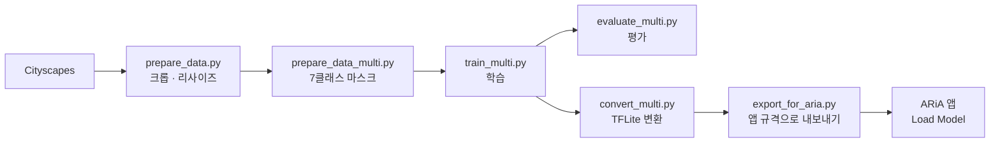

#보행 환경 인식 세그멘테이션 모델 (AI 모델 파트)

카메라 영상에서 **걸을 수 있는 영역(인도·횡단보도)과 막힌 영역(도로·사람·차량·기둥/표지판 등)을 픽셀 단위로 구분**하는 경량 시맨틱 세그멘테이션 모델
안드로이드 앱에서 온디바이스(LiteRT/TFLite)로 실행하는 것을 목표로 하며, 이 문서는 모델 학습부터 앱 연동까지 AI 파트의 작업 내용을 정리


---

## 1. 한눈에 보기

| 항목 | 내용 |
|---|---|
| 태스크 | 시맨틱 세그멘테이션 (7클래스) |
| 모델 | MobileNetV2 인코더(ImageNet 사전학습) + 경량 U-Net 디코더 |
| 학습 데이터 | Cityscapes (라벨을 7클래스로 합쳐서 사용) |
| 학습 입력 | 224 × 512 (H × W), RGB, 0~255 |
| 앱용 입력 | 288 × 512 (H × W), RGB, 0~1 float32 |
| 출력 | `[1, H, W, 7]` 클래스별 확률(softmax) → 픽셀별 argmax |
| 배포 형식 | `.tflite` (LiteRT 호환), 앱에서 직접 불러와 테스트 |

### 파이프라인



---

## 2. 설계 결정 기록

| 결정 | 이유 |
|---|---|
| 이미지 단위 이진분류 → **픽셀 단위 세그멘테이션** | 분류는 "장애물 있음/없음"만 알려주지만, 세그멘테이션은 길이 어느 쪽에 열려 있는지(좌/중/우)까지 알 수 있음. 학습하지 않은 물체도 "걸을 수 있는 바닥이 아니면" 막힌 곳으로 처리됨 |
| 객체 검출(OD) 모델은 제외 | 박스/이름보다 "걸을 수 있는 영역"이 이 프로젝트에 더 직접적이고, 모델 하나로 단순하게 유지하기 위함 |
| **도로는 보행 불가로 분류** | 보행 가능 = 인도 + 횡단보도 |
| 공개 사전학습 세그멘테이션 모델을 그대로 쓰지 않음 | 공개 모델은 자기 데이터셋의 클래스 체계(예: Cityscapes 19클래스)를 따라서 원하는 6클래스와 맞지 않음. 라벨을 합쳐서 직접 학습 |
| 시맨틱(영역) 세그멘테이션 | 같은 클래스의 객체는 하나의 영역으로 묶임 (사람 2명 → 하나의 `person` 영역). 개별 객체 구분(인스턴스)은 모바일에서 무거워 제외 |
| 인코더로 MobileNetV2 사용 | U-Net 스킵 연결 레이어가 잘 알려져 있고 TFLite 변환이 안정적 |
| 학습 이미지 아래쪽 크롭 | Cityscapes 일부 장면에 자동차 보닛이 찍혀 있어, 그대로 두면 "화면 아래 가운데는 항상 막힘"으로 학습됨 |

---

## 3. 클래스 정의

| ID | 클래스 | Cityscapes 원본 라벨 | 보행 가능 |
|---|---|---|---|
| 0 | `other` (기타·막힘) | 위에 해당하지 않는 모든 것 (건물, 벽, 울타리, 식생, 지형, 하늘 등) | ✗ |
| 1 | `road` (도로) | road, parking, rail track | ✗ |
| 2 | `sidewalk` (인도) | sidewalk | ✓ |
| 3 | `crosswalk` (횡단보도) | **없음** (Cityscapes는 도로에 포함) | ✓ |
| 4 | `person` (사람) | person, rider | ✗ |
| 5 | `vehicle` (차량) | car, truck, bus, caravan, trailer, train, motorcycle, bicycle | ✗ |
| 6 | `pole_sign` (기둥·차단봉·표지판) | pole, polegroup, traffic light, traffic sign | ✗ |

- **보행 가능 클래스는 `{2, 3}`** 입니다 (`seg_multi.py`의 `WALKABLE`).
- 클래스 개수와 순서는 앱 코드(`WalkableSegmenter.kt`의 `NAMES`)와 반드시 같아야 합니다.
- 횡단보도(3)는 Cityscapes에 별도 라벨이 없어서 **현재 학습 데이터에는 비어 있음** 구조는 7클래스로 고정해 두었기 때문에, 데이터를 추가해 재학습해도 앱 코드는 바뀌지 않음.

---

## 4. 데이터

### 4.1 Cityscapes

- 학습 2,975장 / 검증 500장 사용. 시험(test) 셋은 정답이 공개되지 않아 사용하지 않음.
- 다운로드: [cityscapes-dataset.com](https://www.cityscapes-dataset.com) 로그인 후 `gtFine_trainvaltest.zip`, `leftImg8bit_trainvaltest.zip`
- 압축을 아래처럼 풉니다 ("현재 폴더에 풀기"로 풀어서 폴더가 한 단계 더 생기지 않게 주의).

```
cityscapes/
  leftImg8bit/{train,val,test}/<도시>/*_leftImg8bit.png
  gtFine/{train,val,test}/<도시>/*_gtFine_labelIds.png
```

> ⚠️ **라이선스**: Cityscapes는 비상업적 연구 목적의 라이선스입니다. 상업적 사용 가능 여부는 약관을 확인

### 4.2 전처리

| 단계 | 내용 |
|---|---|
| 크롭 | 2048×1024 → 위쪽 2048×896 (아래쪽 보닛 영역 제거) |
| 리사이즈 | 512×224 (이미지는 bilinear, 마스크는 nearest) |
| 라벨 변환 | `labelIds` → 7클래스 ID (위 표) |

---

## 5. 모델

```
입력 (224×512×3, 0~255)
  → Rescaling(1/127.5, offset=-1)            # MobileNetV2 입력 범위 [-1, 1]
  → MobileNetV2 인코더 (ImageNet 사전학습)
       스킵: block_1_expand_relu / block_3_expand_relu / block_6_expand_relu
             block_13_expand_relu / block_16_project
  → 디코더: [Conv2DTranspose → 스킵 Concat → Conv2D] × 4단계 (256/128/64/32)
  → Conv2DTranspose(16) → Conv2D(1×1, 7, softmax)
출력 (224×512×7)
```

구조는 합성곱으로만 이뤄져 있어서 가중치를 그대로 두고 입력 크기만 바꿔 내보낼 수 있음, (`export_for_aria.py`, 288×512). 입력 크기는 **32의 배수**여야 합니다.

---

## 6. 학습

| 항목 | 값 |
|---|---|
| 손실 | Sparse Categorical Cross-Entropy + Multi-class Dice |
| 지표 | Mean IoU |
| 배치 | 8 |
| 증강 | 좌우 반전, 밝기(±25), 대비(0.8~1.2) |
| 1단계 | 인코더 동결, Adam 1e-3, 5 에폭 |
| 2단계 | 전체 파인튜닝, Adam 1e-4, 최대 40 에폭 |
| 콜백 | EarlyStopping(`val_miou`, patience 6, 최적 가중치 복원), ReduceLROnPlateau(×0.5, patience 3), ModelCheckpoint |
| 환경 | Windows CPU (이진 베이스라인 기준 약 5분/에폭). 오래 걸리면 Google Colab GPU 권장 |

> 학습은 최종 `model.save()`가 끝에서 한 번 실행되므로 Ctrl+C로 중간에 끄면 저장된 모델이 없을 수 있음. (ModelCheckpoint가 최고 모델을 따로 저장).

---

## 7. 평가

`evaluate_multi.py`가 아래를 출력하고, `seg_preview_multi/`에 예측 오버레이 이미지를 저장합니다.

- **클래스별 IoU** (데이터가 없는 클래스는 `-`로 표시)
- 인도+횡단보도를 "보행 가능", 나머지를 "불가능"으로 합친 **안전 지표**
  - 보행가능 정밀도: 걸을 수 있다고 한 곳이 실제로 맞는 비율
  - 보행가능 재현율
  - **막힌 곳 재현율**: 막힌 곳을 막혔다고 맞힌 비율 → 장애물을 길로 착각하는 가장 위험한 오류와 직결되므로 우선 확인

### 결과

**이진(보행 가능/불가능) 베이스라인** — 7클래스 모델 이전에 학습한 모델, 학습 중 로그(Epoch 14/40 시점) 기준:

| val IoU | val 보행가능 정밀도 | train IoU |
|---|---|---|
| 0.925 | 0.947 | 0.970 |

**7클래스 모델** — `TODO` 학습 완료 후 기입

| 클래스 | IoU |
|---|---|
| other | `TODO` |
| road | `TODO` |
| sidewalk | `TODO` |
| crosswalk | 데이터 없음 |
| person | `TODO` |
| vehicle | `TODO` |
| pole_sign | `TODO` |

| 보행가능 정밀도 | 보행가능 재현율 | 막힌 곳 재현율 |
|---|---|---|
| `TODO` | `TODO` | `TODO` |

---

## 8. 실행 방법 (Windows / PowerShell)

### 8.1 환경

```powershell
python -m venv venv
Set-ExecutionPolicy -Scope Process -ExecutionPolicy Bypass   # 활성화 스크립트 오류가 나면
venv\Scripts\Activate.ps1
pip install tensorflow pillow opencv-python
```

> Keras 3 기준입니다. `&&`는 PowerShell 5에서 동작하지 않으니 명령을 한 줄씩 실행하세요.

### 8.2 데이터 준비 → 학습 → 평가 → 변환

```powershell
python prepare_data.py          # 이미지 크롭/리사이즈 → seg_data/ (이진 마스크 포함)
python prepare_data_multi.py    # 7클래스 마스크 → seg_data/*/masks_multi/
python train_multi.py           # 학습 → walkable_seg_multi.keras
python evaluate_multi.py        # 평가 + 미리보기 이미지
python convert_multi.py         # TFLite 변환 → walkable_seg_multi.tflite
```

`prepare_data_multi.py`는 `prepare_data.py`가 만든 `seg_data/*/images`를 재사용하므로 **반드시 `prepare_data.py`를 먼저** 실행해야 합니다.

### 8.3 영상으로 테스트 (PC)

```powershell
python test_video_multi.py      # test.mp4 → result_multi.mp4
```

`test_video_multi.py` 상단의 설정을 조정합니다.

| 설정 | 설명 |
|---|---|
| `SOURCE` | 영상 경로, 웹캠이면 `0` |
| `FIT` | `"stretch"`(프레임 전체를 늘림) / `"crop"`(아래쪽을 모델 비율로 자름). 둘 다 돌려 비교 |
| `FREE_THRESH` | 가운데 보행 가능 비율이 이 값보다 낮으면 `OBSTACLE` (기본 0.6) |

화면 아래 45% 영역을 좌/중/우로 나눠 보행 가능 비율을 계산하고, 막힌 경우 어떤 클래스가 막았는지(`blocked by`)도 표시

---

## 9. ARiA 앱 연동

### 9.1 앱용 모델 내보내기

```powershell
python export_for_aria.py       # → walkable_seg_aria.tflite (약 21MB, float32)
```

| 항목 | 규격 |
|---|---|
| 입력 | `[1, 288, 512, 3]` float32, RGB, **0~1** (앱 정규화 방식에 맞춤) |
| 출력 | `[1, 288, 512, 7]` float32 (softmax) |
| 최소 런타임 | TFLite 2.13.0 (변환 환경 TF 2.21 기준) |

`USE_FP16 = True`로 바꾸면 파일 크기가 줄어듬 (GPU에서 유리할 수 있음, 기본은 False).

### 9.2 앱에서 모델 불러오기

1. 모델 파일(`walkable_seg_aria.tflite`)을 폰 저장소로 복사
2. 앱 실행 → ⚙️ 설정 → **Load Model (.tflite)** → 파일 선택
3. 상태가 `Model Loaded`로 바뀌면 결과 마스크 표시

> 앱 소스에 `loadModelFromAssets`가 있지만 호출되는 곳이 없어서 `assets` 폴더에 넣어도 자동 로드되지 않음.

마스크 색상(앱 `CLASS_COLORS` 기준): 투명=기타 / 빨강=도로 / **초록=인도** / **파랑=횡단보도** / 노랑=사람 / 자홍=차량 / 청록=기둥·표지판

### 9.3 앱 수정 사항 (`ariaCamTest`)

| 파일 | 변경 |
|---|---|
| `util/ImageUtils.kt` | 프레임을 정사각형 중앙 크롭 대신 **모델 비율(512:288)로 자르기**, 세로가 남으면 아래쪽(길)을 남김 |
| `ui/CameraScreen.kt` | 분석 해상도 요청 288×288 → 640×480, 입력 폭 512, 표시 문구 수정 |


### 9.4 앱 판단 로직 (참고 구현)

`WalkableSegmenter.kt`는 마스크에서 화면 하단 영역을 좌/중/우로 나눠 **보행 가능 비율**과 **가운데를 막은 클래스**를 돌려주는 샘플.

```kotlin
val r = segmenter.analyze(bitmap)
val obstacle = r.free[1] < 0.6f      // 가운데 보행 가능 비율이 낮으면 장애물
```

> 이 앱의 `LiteRtSegmenter`는 `org.tensorflow.lite`(TFLite 2.16.1)를 사용합니다. 모델 로드 시 `Didn't find op for builtin opcode` 오류가 나면 LiteRT(`com.google.ai.edge.litert`) 의존성으로 올리고 import 패키지를 바꿔야 함.

---

## 10. 저장소 구조

| 파일 | 설명 |
|---|---|
| `prepare_data.py` | Cityscapes 이미지 크롭·리사이즈 + 이진 마스크 생성 |
| `prepare_data_multi.py` | 7클래스 마스크 생성 (`masks_multi/`) |
| `seg_multi.py` | 데이터 로더, 모델 정의, 손실 함수 (클래스 목록·`WALKABLE` 포함) |
| `train_multi.py` | 2단계 학습 |
| `evaluate_multi.py` | 클래스별 IoU, 안전 지표, 미리보기 |
| `convert_multi.py` | Keras → TFLite 변환 및 결과 비교 |
| `export_for_aria.py` | 앱 규격(288×512, 0~1 입력)으로 내보내기 |
| `test_video_multi.py` | 영상/웹캠으로 PC에서 결과 확인 |
| `WalkableSegmenter.kt` | 앱용 후처리 샘플 (좌/중/우 비율, 막은 클래스) |
| `seg_common.py`, `train_seg.py`, `evaluate_seg.py`, `convert_seg.py`, `test_video.py` | 이진(보행 가능/불가능) 베이스라인 |
| `train.py`, `evaluate.py`, `convert.py` | 초기 이진분류(이미지 단위) 실험, 현재 방식으로 대체됨 |

### `.gitignore` 권장

```gitignore
venv/
__pycache__/
cityscapes/        # 데이터셋 원본은 올리지 않음
seg_data/
seg_preview*/
*.keras
saved_model_tmp/
result*.mp4
test.mp4
```


---

## 11. 알려진 한계

- **횡단보도 미학습**: Cityscapes에서는 도로에 포함되어 있어 현재 모델은 횡단보도를 도로(막힘)로 판단.
- **차단봉(볼라드) 별도 클래스 없음**: 기둥·표지판 계열(`pole_sign`)로 매핑되며, 볼라드가 정확히 이 클래스로 잡힌다고 보장되지 않음.
- **시점 차이**: Cityscapes는 자동차 앞유리 높이에서 찍은 유럽 도시 장면입니다. 사람 눈높이·낮은 위치·실내 환경에서는 성능이 떨어질 수 있음.
- **인스턴스 구분 불가**: 같은 클래스의 객체는 하나의 영역으로 나옴.
- **위험 지형**: 구덩이, 계단 아래 같은 지형은 색만으로는 "바닥"으로 보여 놓칠 수 있음.
- **앱 패치/온디바이스 검증**: 앱 수정 사항은 빌드·실기기 검증이 필요합니다. 현재 테스트 앱은 폰 내장 카메라만 사용하며 외부 카메라 연결은 구현되어 있지 않음.

---

## 12. TODO

- [ ] 7클래스 모델 학습 완료 후 평가 결과(7장) 기입
- [ ] 직접 촬영한 영상으로 PC 테스트 (`FIT` stretch/crop 비교)
- [ ] 앱 패치 빌드 및 실기기 테스트 (추론 시간, FPS 측정)
- [ ] 횡단보도 데이터 추가 (예: Mapillary Vistas 등) 후 재학습 — 클래스 구조 유지
- [ ] 자체 촬영 영상으로 자동 라벨링 후 보정 → 파인튜닝
- [ ] 막힌 곳 재현율 기준 임계값(`FREE_THRESH`) 조정
- [ ] 속도 최적화 (FP16/양자화, GPU 위임 확인)
- [ ] 외부 카메라 연결 연동
